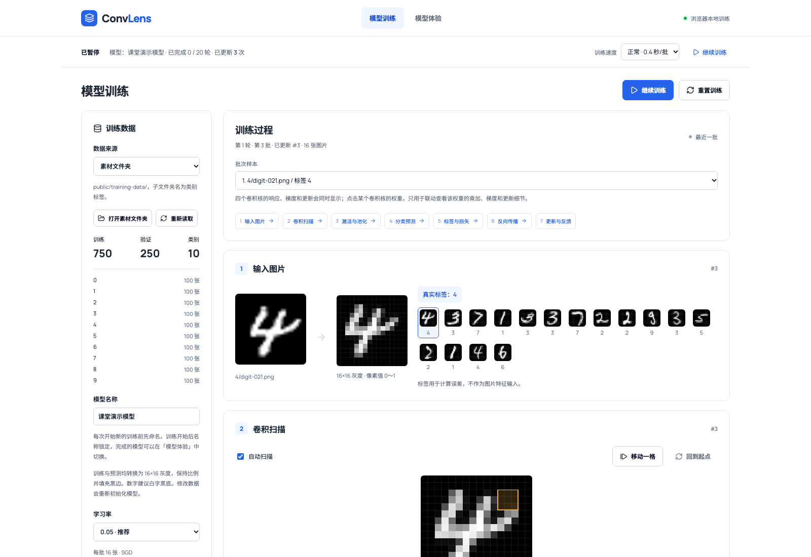
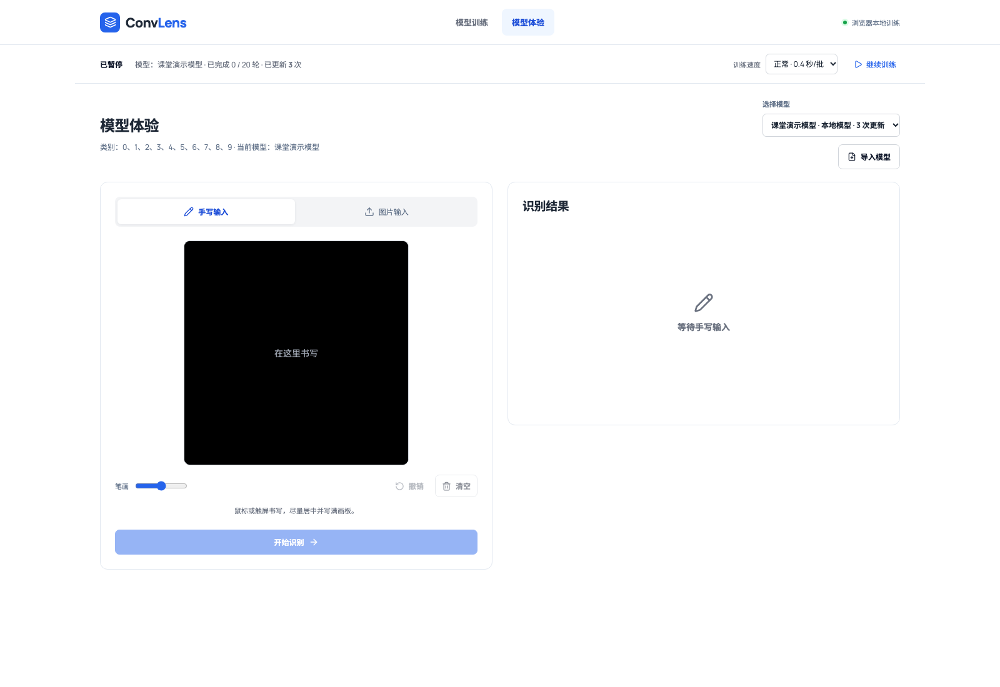

# ConvLens

<p align="center">
  <strong>在浏览器里看见 CNN 的每一次学习</strong><br>
  面向人工智能通识课的卷积神经网络可视化实验室
</p>

<p align="center">
  <a href="https://github.com/SohriCarryU/ConvLens"></a>
  
  
  
</p>

<p align="center">
  <a href="#项目定位">项目定位</a> ·
  <a href="#平台界面">平台界面</a> ·
  <a href="#快速开始">快速开始</a> ·
  <a href="#你能看到什么">功能亮点</a> ·
  <a href="#素材文件夹">数据与模型</a> ·
  <a href="#真实计算链路">计算链路</a> ·
  <a href="#验证与构建">开发验证</a>
</p>

---

ConvLens 是面向**人工智能通识课**的演示与实操教学工具。它把一次 CNN 训练拆成可以逐步观察、逐步操作的实验过程，帮助学生把课堂中的公式和网络结构对应到真实计算：从输入图片、卷积扫描、ReLU 与池化，到分类、损失、反向传播和参数更新。所有计算都在浏览器中完成，界面采用白色简约风格。

## 项目定位

ConvLens 用来辅助教师讲解和学生上手实践，适合课堂演示、课后复现和概念复习。它关注“模型为什么得到这个结果、参数如何改变”，而不是只展示最终准确率。

- **教师演示**：按训练阶段定位讲解，展示同一批样本从输入到更新的完整链路。
- **学生实操**：调节训练速度、暂停训练、选择样本和卷积核权重，直接观察计算细节。
- **概念理解**：把卷积、激活、池化、Softmax、交叉熵、梯度下降等抽象概念变成可观察的中间结果。
- **低门槛运行**：无需 GPU、无需 Python 环境和远程服务，打开浏览器即可完成训练与预测。

平台定位是教学辅助工具，不追求生产级模型精度；默认数据和小型网络结构优先服务于可解释性和课堂节奏。

## 平台界面

训练页将一批数据的计算过程集中展示，教师可以从顶部阶段导航跳转到卷积、预测、损失或反向传播等环节；学生可以点击卷积核权重，联动查看像素乘加、梯度贡献和更新公式。

<p align="center">
  
</p>
<p align="center"><sub>训练过程：批次样本、卷积扫描和阶段定位集中在同一页面。</sub></p>

模型体验页提供手写输入、图片输入和本地模型选择，适合课堂演示训练结果，也适合学生用自己的图片进行即时验证。

<p align="center">
  
</p>
<p align="center"><sub>模型体验：选择已保存模型，用手写或图片输入进行预测。</sub></p>

## 你能看到什么

- **七阶段训练过程**：输入图片、卷积扫描、激活与池化、分类预测、标签与损失、反向传播、更新与反馈。
- **同步批次快照**：每个批次完成后，所有视图一起刷新，避免混用不同批次或尚未应用的参数。
- **四个卷积核全量展示**：响应、权重梯度、更新前后权重和变化量同时呈现；点击权重即可联动查看乘加、梯度贡献和更新公式。
- **可回放的卷积扫描**：自动扫描当前 3×3 窗口，也可以点击图片或拖动滑块定位到任意位置。
- **模型体验**：支持浏览器手写、验证样本和上传图片测试，显示类别概率与卷积特征图。
- **本地模型管理**：训练完成后自动保存到浏览器，可在模型体验页选择，也可从顶部导出 JSON 或导入已有模型。
- **自定义数据集**：从 public/training-data/ 读取类别文件夹，也可以临时上传带标签的图片。

## 快速开始

需要 Node.js 22.18+（数值测试使用原生 TypeScript 类型剥离）。

```bash
npm install
npm run dev
```

打开 http://localhost:5173/ 。

1. 模型训练页读取 `public/training-data/` 中的 PNG/JPG/WebP 文件。示例包含 0–9 共十类，1,000 张 MNIST 真实手写数字图片，750 张训练、250 张验证；图片独立存放，不嵌入前端代码。
2. 点击「开始训练」立即计算第一批。顶部固定栏的「训练速度」支持每批 0.2、0.4、1、2、5、10 秒，默认 0.4 秒。训练中可直接调速，卷积扫描同步放慢或加快，不重置模型。
3. 输入图片、卷积扫描、激活与池化、分类预测、标签与损失、反向传播、更新与反馈全部展开在训练页。每批完成后，所有区域一起刷新为同一批次的结果。
4. 卷积扫描自动回放当前批次；也可点击图片或拖动滑块选择窗口。固定窗口只停止扫描动画，不停止训练，像素、权重和乘加结果仍随新批次刷新。
5. 4 个卷积核的权重、响应、梯度、更新前后数值及变化量同时展示。点选任一卷积核的权重，联动乘加、梯度贡献和更新公式明细。样本选择对应批次中的位置，最后一个不完整批次自动限制到有效位置。
6. 没有独立的透镜页面，也无需手动应用更新。只有「暂停训练」会暂停模型；「继续训练」恢复定时更新。
7. 每次开始新的训练前先填写模型名称；名称会在训练开始后锁定。点击「重置训练」或切换数据集会创建新的训练草稿，之前命名的模型仍保留在当前页面。
8. 「模型体验」可以从「选择模型」中切换已命名的本地模型，使用它各自保存的参数、类别和样本。训练完成后模型会自动保存到当前浏览器；也可以导出 JSON 模型文件，之后通过「导入模型」恢复并选择。支持浏览器手写、验证样本或上传图片测试，切换页面不会暂停训练。

训练草稿和临时上传图片只保留在当前页面中，刷新会重置；已经完成并保存的模型会保留在浏览器本地存储中。模型文件不包含原始图片 Data URL，只保留推理所需的像素、标签和参数。

## 素材文件夹

```text
public/training-data/
  0/digit-001.png
  0/digit-002.png
  1/digit-001.png
  2/digit-001.png
```

训练页点击「打开素材文件夹」，直接在系统文件管理器中打开 `public/training-data/`（macOS 为 Finder），可进入类别文件夹查看原图。打开文件夹不会切换页面或暂停训练。示例文件是从 MNIST 训练集抽取的真实手写数字 PNG。

此按钮需要在运行网站的电脑上，通过 `localhost` 或 `127.0.0.1` 访问 `npm run dev` 启动的服务；本机 `npm run preview` 则打开实际提供图片的 `dist/training-data/`。纯静态托管无法调用电脑的文件管理器，失败时页面会提示。临时上传图片没有对应的素材目录，因此该模式不显示此按钮。

文件夹名作为标签。添加、删除或替换图片，或者新增类别子文件夹后，在训练页暂停并点击「重新读取」。开发服务每次重新扫描磁盘，无需修改代码或手工维护清单；重新读取会重置模型。每类按文件名排序，每 4 张取 1 张用于验证，其余参与训练。PNG、JPG、WebP 可混用，类别内嵌套目录也会读取，隐藏文件与符号链接忽略。

构建时自动生成素材清单，图片单独复制到 `dist/training-data/`，浏览器按文件读取。发布静态站点后修改素材需重新执行 `npm run build`。文件读取失败会显示错误，不会退回代码生成的样本。

`scripts/import-mnist.mjs` 从 MNIST 的 IDX gzip 文件导入图片；`scripts/export-demo-images.mjs` 仅用于离线合成样本测试，不在启动、训练或构建时运行，不覆盖已有文件。

## 手写识别

在「模型体验 → 手写输入」中用鼠标、触屏或触控笔书写，再点击「开始识别」。画板支持调整笔画粗细、撤销上一笔和清空；右侧显示 16×16 模型输入、类别概率和卷积特征。修改笔画会清除上一次识别结果，避免结果与当前输入不一致。切换到「图片输入」可继续使用上传图片和样本测试，切回时保留画板。

画板采用黑底白字，与图片上传共用等比缩放、灰度化和归一化处理。默认模型包含 0–9 十类，需先训练；手写输入和素材图片仍会因书写风格、位置和线宽不同产生误差。识别始终使用当前模型，没有额外的手写识别服务。

## 真实计算链路

```text
16×16 灰度图
  → Conv（4 个可学习的 3×3 核，stride=1，无 padding）
  → 4 张 14×14 响应
  → ReLU
  → 2×2 平均池化（stride=2）
  → 4 张 7×7 特征图，展平为 196 维
  → 全连接分类层 → Softmax 概率
  → 与真实标签比较：交叉熵损失
  → p-y → 分类层 → 平均池化 → ReLU → 卷积核的梯度
  → 批次平均梯度 → SGD：新权重 = 旧权重 - 学习率 × 梯度
  → 使用新参数重新预测同一图片
```

默认十类模型有 2,010 个可训练参数。所有核、特征、概率、损失、梯度、参数前后对比和指标都由浏览器中的 TypeScript 计算引擎产生，无随机伪造曲线或固定预测结果。

训练过程展示最近一次已完成更新的不可变计算快照。每次定时更新先计算、再提交，完成后才发布整批结果；不会混用不同批次或显示尚未应用的参数。扫描是计算结果的可视化回放，并非模型执行的调度器。数值显示做了舍入，热力图显示强度按图缩放，计算值本身不缩放。单张图片的改善不保证整体验证效果也改善。

## 自己的数据

持久素材放入上述类别文件夹。也可以在模型训练页选择「临时上传图片」，填写类别名并分批添加对应图片，例如先标注“猫”，再标注“狗”。至少两个类别，每类建议十张以上；临时上传不会写入项目目录，刷新后不保留。

- 上传图片会真正参与训练，而不是仅用于卷积展示。
- 临时上传每类每 5 张留 1 张作验证；文件夹素材每 4 张留 1 张。不足时可能没有验证样本。
- 所有图片采用相同预处理：保持比例缩放，黑边填充到 16×16，转为灰度并归一化到 0～1。
- 数字图片建议白字黑底，与内置数据风格一致。
- 添加数据、切换数据集会重新初始化模型；训练期间数据编辑被锁定，可先暂停或重置。
- 单张上限 15MB，每次最多 60 张；支持浏览器可解码的 PNG/JPG/WebP。

这是一层卷积的小模型，用于完整、易理解的课堂实验。默认数据是 MNIST 的抽样真实手写数字；验证集结果不代表所有人的手写数字都能准确识别。猫狗等类别需自行提供带标签数据，16×16 灰度和小模型容量会限制效果。特征图展示真实卷积响应，不是注意力解释。

## 验证与构建

```bash
npm test
npm run build
```

- 数值差分校验卷积核、偏置、分类层和输入的反向传播梯度。
- 校验批次平均、不可变快照、单次提交、实时发布的一致性、最后一个不完整批次、重置与训练结束。
- 校验文件夹标签、排序、验证集划分、新增/替换/删除文件的重新扫描。
- 校验打开文件夹接口只接受本机同源操作、目标目录固定及异常反馈。
- 验证真实训练能降低未参与更新的验证集损失。
- 构建前执行 TypeScript 检查，产物位于 `dist/`。

主要文件：`src/cnn.ts`（前向与反向计算）、`src/trainer.ts`（批次和更新）、`src/TrainingProcess.tsx`（七阶段实时训练过程）、`src/folderDataset.ts`（图片文件读取）、`scripts/training-files.mjs`（目录扫描与清单）、`src/App.tsx`（训练与数据管理）。

## 发布桌面版本

项目支持用 Electron 打包为 Windows 和 macOS 桌面应用。桌面版会在本机启动一个仅监听 `127.0.0.1` 的静态服务，因此训练素材读取、浏览器本地模型保存和“打开素材文件夹”功能都能继续使用。

本机开发或测试桌面版：

```bash
npm run desktop:dev
```

本机生成当前操作系统的安装包：

```bash
npm run desktop:dist -- --mac --arm64  # Apple Silicon Mac
npm run desktop:dist -- --mac --x64    # Intel Mac
npm run desktop:dist -- --win --x64    # Windows x64
```

产物会写入 `release/`。Windows 会生成安装版和便携版；macOS 会生成 DMG 和 ZIP。默认 `unsigned` 模式不使用开发者证书，首次启动时系统可能显示安全提示。公开分发可配置 `signed` 模式：Windows 支持 PFX 或 Azure 云签名，macOS 支持 Developer ID 签名、Hardened Runtime 与 Apple 公证。凭据仅通过 GitHub Secrets 注入；启用签名后，缺少凭据或原生验证失败都会阻止发布。配置方法、证书前置条件及验证范围见 [桌面安全发布指南](docs/desktop-security-release.md)。

推送新的版本标签后，GitHub Actions 会在原有三个构建环境中打包，验证后先创建草稿 Release；下载附件复核 SHA256 成功后才公开。已有 Release 会被拒绝覆盖。手动运行工作流（包括选择已有标签）仅构建和验证，不会发布。

例如，完成下一版本号更新后：

```bash
version=0.1.3  # 示例；必须与 package.json 中的新版本号一致
git add .
git commit -m "release: v${version}"
git tag -a "v${version}" -m "ConvLens v${version}"
git push origin main --follow-tags
```

工作流会生成：

- Windows x64：安装版 `.exe` 和便携版 `.exe`
- macOS Intel：`.dmg` 和 `.zip`
- macOS Apple Silicon：`.dmg` 和 `.zip`

版本号来自 `package.json`。发布下一个版本前，先更新 `version`（包括 lockfile 根版本号），再创建对应的 `v*` 标签。六个安装包保持现有命名；Release 同时提供 `SHA256SUMS.txt` 和 `SECURITY-VERIFICATION.json`，说明该次构建的签名模式和各产物哈希。SHA256 能检查完整性，不能替代发布者签名。v0.1.2 的既有安装包仍然是未签名、未公证版本。
